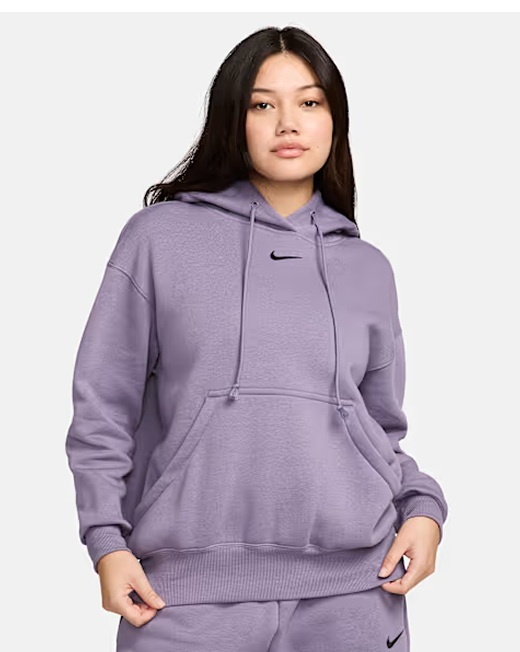
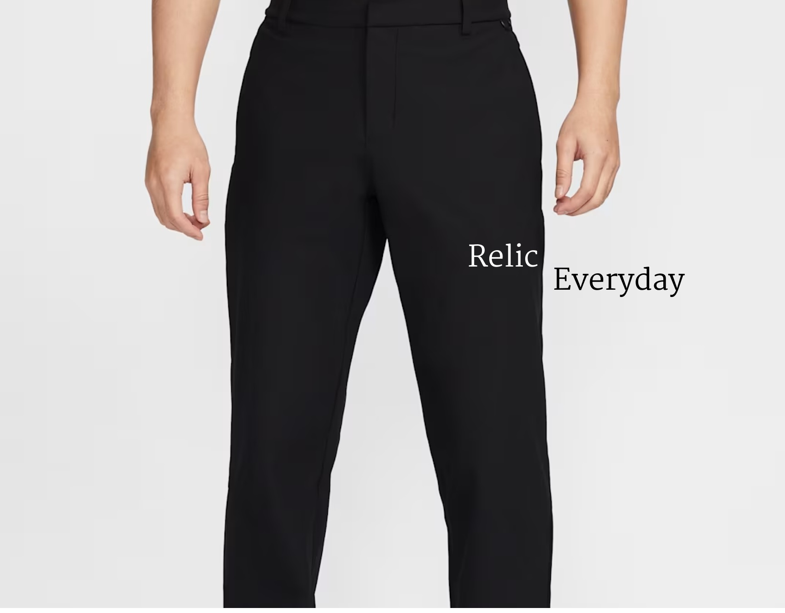

# ⚡ DOOM REVERSAL — E-Commerce & Everyday Essentials Web Project

<div align="center">


*“When the end feels near, turn it around and start again.”*

</div>

---

## 📖 Tentang Proyek

**Doom Reversal** adalah aplikasi web e-commerce berbasis **PHP Native** yang dikembangkan sebagai proyek tugas akhir mata kuliah Pemrograman Berbasis Web. Mengusung konsep *brand* pakaian modern (hoodie dan *everyday essentials*), aplikasi ini dirancang dengan struktur kode yang bersih (*clean code*), modular, serta menerapkan standar keamanan web modern tanpa menggunakan *framework* pihak ketiga.

Proyek ini dibangun secara kolaboratif oleh tim beranggotakan 5 orang (**Krisna, Fariz, Abay, Nafero, dan Dika**) dengan menerapkan pemisahan tanggung jawab (*separation of concerns*) yang ketat pada arsitektur backend, manajemen database, routing, dan keamanan sesi.

---

## ✨ Fitur Utama (Backend Focus)

1. **Front Controller & Dynamic Routing (`index.php`)**: Semua permintaan (*requests*) berpusat pada satu pintu masuk menggunakan sistem *whitelist routing* yang aman dari celah *Local File Inclusion* (LFI).
2. **Katalog Produk & Filter Canggih**: Fitur penjelajahan produk berdasarkan kategori (*Men, Women, Pants, Kids*), pencarian real-time berdasarkan nama atau warna, serta pengurutan berdasarkan harga dan nama alfabetis.
3. **Manajemen Keranjang Belanja (*Cart Management*)**: Pengelolaan item keranjang berbasis *session* dengan perulangan `while` dan validasi kuantitas yang ketat (maksimal 20 item per varian ukuran) serta kalkulasi diskon otomatis 10% jika subtotal mencapai $\ge$ Rp 900.000 menggunakan *accumulator* pada perulangan `for`.
4. **Sistem Autentikasi Pengguna**: Fitur registrasi dan login lengkap dengan *password hashing* (`password_hash`), regenerasi ID sesi untuk mencegah *Session Fixation*, pembatasan percobaan login (*login throttling*), serta proteksi halaman privat (*account*, *checkout*, *payment*).
5. **Simulasi Checkout & Pembayaran dengan Database Transactions**: Alur pemesanan lengkap menggunakan `beginTransaction()`, `commit()`, dan `rollBack()` untuk menjamin konsistensi data antara tabel `orders`, `order_items`, dan `payments`.
6. **Laporan Keranjang Cetak (`Report`)**: Fitur rekapitulasi data belanja menggunakan perulangan terstruktur, *accumulator*, dan fungsi cetak browser (`window.print()`).
7. **Database Error Handling (`Setup Help`)**: Halaman panduan konfigurasi lokal otomatis jika koneksi database belum terhubung, tanpa membocorkan informasi kredensial sensitif.

---

## 🛠️ Tech Stack & Arsitektur Keamanan

* **Bahasa Pemrograman**: PHP (Strict Types enabled `declare(strict_types=1);`)
* **Manajemen Database**: MySQL / MariaDB via **PDO (PHP Data Objects)** menggunakan *Singleton Pattern* untuk efisiensi koneksi.
* **Keamanan Tingkat Lanjut**: 
  * **Native Prepared Statements**: Mencegah celah *SQL Injection* secara total pada seluruh query dinamis dengan menonaktifkan `EMULATE_PREPARES`.
  * **CSRF Protection**: Token validasi acak 32-byte pada setiap pengiriman formulir metode POST yang divalidasi dengan `hash_equals()`.
  * **Output Escaping**: Fungsi `e()` (`htmlspecialchars`) untuk mencegah serangan *Cross-Site Scripting (XSS)*.
  * **Secure Session**: Parameter cookie `httponly`, `samesite=Lax`, dan regenerasi ID session pada titik autentikasi sensitif.

---

## 📁 Struktur Direktori Proyek

```text
doom-reversal/
│
├── assets/
│   ├── images/          # Aset gambar produk dan logo brand
│   ├── style.css        # Berkas lembar gaya (CSS) utama
│   └── app.js           # Skrip pendukung interaksi frontend (JavaScript)
│
├── config/
│   └── database.php     # Konfigurasi koneksi database PDO (Singleton)
│
├── database/
│   └── doom_reversal.sql # Berkas dump SQL inisialisasi tabel dan data produk
│
├── includes/
│   ├── actions.php      # Pemrosesan request form (Cart, Login, Checkout, Pay)
│   ├── bootstrap.php    # Konfigurasi sesi, konstanta global, dan fungsi utilitas
│   ├── database.php     # Pengelola koneksi database PDO (Singleton)
│   ├── layout.php       # Komponen modular UI (headerView, footerView, card)
│   └── products.php     # Inisialisasi data produk dari database ke array asosiatif
│
├── setup-help.php       # Halaman panduan otomatis jika koneksi database gagal
└── index.php            # Front Controller & Router utama aplikasi
```

---

## ⚙️ Panduan Instalasi & Menjalankan Proyek

1. **Clone atau Unduh Repository**  
   Letakkan folder proyek ke dalam direktori server lokal Anda (`htdocs/doom-reversal` di XAMPP atau `www/doom-reversal` di Laragon).

2. **Nyalakan Server Lokal**  
   Pastikan layanan **Apache** dan **MySQL** sudah dalam keadaan aktif (*Running*).

3. **Buat Database Baru**  
   * Buka **phpMyAdmin** melalui browser (`http://localhost/phpmyadmin`).
   * Buat database baru dengan nama: `doom_reversal`.

4. **Import Database**  
   * Pilih database `doom_reversal` yang baru dibuat.
   * Klik tab **Import**, lalu pilih file `database/doom_reversal.sql` dari folder proyek.
   * Klik **Go** / **Kirim** untuk menyelesaikan proses import.

5. **Verifikasi Konfigurasi Database**  
   Periksa file `includes/database.php` untuk memastikan konfigurasi *host*, *port*, *username*, dan *password* sudah sesuai dengan pengaturan server lokal Anda.

6. **Akses Aplikasi**  
   Buka browser dan akses URL berikut:
   ```text
   http://localhost/doom-reversal/index.php
   ```

---

## 👥 PEMBAGIAN TUGAS PRESENTASI BACKEND (5 ANGGOTA)

Dokumen ini menjadi acuan utama seluruh anggota tim (**Krisna, Fariz, Abay, Nafero, Dika**) saat presentasi dan uji kodingan di depan dosen/asdos.

---

### 1️⃣ KRISNA — Front Controller, Routing & Error Handling Fallback
* **File yang Dijelaskan**: `index.php` & `setup-help.php`
* **Naskah & Poin Penjelasan Teknis**:
  1. **Konsep Front Controller (`index.php`)**: *"Di `index.php`, kami menerapkan pola arsitektur **Front Controller**. Seluruh request dari pengguna berpusat di satu pintu masuk ini, sehingga kontrol atas session, keamanan, dan pemuatan dependensi menjadi jauh lebih terpusat dan mudah diawasi."*
  2. **Whitelist Routing & Proteksi LFI**: *"Sistem navigasi menggunakan sistem whitelist pada array `$allowed`. Jika parameter `?page=` tidak terdaftar atau mencoba disusupi oleh penyerang (misal mencoba Local File Inclusion), sistem otomatis memblokirnya dan melempar status HTTP `404`."*
  3. **Error Handling & Graceful Degradation (`setup-help.php`)**: *"Jika koneksi database gagal atau belum di-import, aplikasi tidak akan membiarkan error PHP mentah terekspos. Blok penanganan error langsung mengalihkan tampilan ke `setup-help.php` dengan status HTTP `503`, menjaga keamanan kredensial sistem."*

---

### 2️⃣ FARIZ — Business Logic, Transaction Handler & Data Mapping
* **File yang Dijelaskan**: `actions.php` & `products.php`
* **Naskah & Poin Penjelasan Teknis**:
  1. **Pengendali Logika POST (`actions.php`)**: *"File `actions.php` adalah pusat pemrosesan data POST, mulai dari manajemen keranjang belanja, autentikasi user, hingga proses checkout."*
  2. **Database Transactions (`beginTransaction`, `commit`, `rollBack`)**: *"Pada proses checkout dan pembayaran, kami menerapkan transaksi database penuh. Jika terjadi kegagalan di tengah jalan saat menyimpan tabel `orders`, `order_items`, atau `payments`, sistem otomatis menjalankan `rollBack()` untuk menjaga agar data tidak korup atau tersimpan setengah-setengah."*
  3. **Data Mapping Produk (`products.php`)**: *"Melalui `products.php`, data produk ditarik dari database menggunakan PDO lalu dipetakan (*mapping*) ke dalam array asosiatif berbasis ID produk, lengkap dengan casting tipe data eksplisit agar performa akses di seluruh halaman menjadi sangat cepat."*

---

### 3️⃣ ABAY — Core Foundation, Sesi Aman & Proteksi CSRF/XSS
* **File yang Dijelaskan**: `bootstrap.php` (Bagian Sesi & Keamanan)
* **Naskah & Poin Penjelasan Teknis**:
  1. **Inisialisasi Sesi Aman**: *"Di `bootstrap.php`, kami mengonfigurasi cookie sesi secara ketat menggunakan parameter `httponly => true` dan `samesite => 'Lax'`. Ini berfungsi mutlak untuk membentengi aplikasi dari pencurian sesi via JavaScript (*XSS Cookie Theft*) dan serangan lintas situs (*CSRF*)."*
  2. **Proteksi CSRF Token**: *"Setiap formulir POST wajib menyertakan token acak kriptografis 32-byte yang divalidasi menggunakan fungsi `hash_equals()`. Mekanisme ini mencegah serangan Timing Attack dan memastikan form tidak bisa dibajak oleh situs luar."*
  3. **Sanitasi Output XSS (`e()`)**: *"Seluruh data yang dicetak kembali ke layar wajib melewati fungsi `e()` yang membungkus `htmlspecialchars()`, melumpuhkan potensi injeksi skrip berbahaya dari pengguna."*

---

### 4️⃣ NAFERO — Akumulator Keuangan & Cart Management
* **File yang Dijelaskan**: `bootstrap.php` (Bagian Logika Keranjang & Diskon)
* **Naskah & Poin Penjelasan Teknis**:
  1. **Pengolahan Keranjang Menggunakan `while`**: *"Untuk membaca item di dalam keranjang sesi, kami memanfaatkan perulangan terstruktur **`while`** yang dikombinasikan dengan fungsi `array_keys()` guna memastikan setiap varian produk (berdasarkan ukuran dan ID) terbaca secara akurat."*
  2. **Kalkulasi Akumulator Menggunakan `for`**: *"Perhitungan total subtotal belanja dikerjakan oleh fungsi `totals()` menggunakan perulangan **`for`** dengan konsep *accumulator* (`$subtotal += ...`) untuk menjumlahkan seluruh harga item secara iteratif."*
  3. **Otomatisasi Diskon 10%**: *"Sistem secara otomatis mengecek ambang batas diskon (`DISCOUNT_THRESHOLD` sebesar Rp 900.000). Jika subtotal memenuhi syarat, sistem memotong harga sebesar 10% secara presisi tanpa ada selisih hitung."*

---

### 5️⃣ DIKA — Database Connection & Singleton PDO Security
* **File yang Dijelaskan**: `database.php`
* **Naskah & Poin Penjelasan Teknis**:
  1. **Singleton Pattern**: *"Koneksi database dielola melalui fungsi `db()` di dalam `database.php` dengan menerapkan **Singleton Pattern** menggunakan variabel `static $connection`. Ini memastikan koneksi database hanya dibuka sekali saja selama siklus request HTTP, sehingga menghemat sumber daya server."*
  2. **Konfigurasi Atribut PDO**: *"Kami mengonfigurasi PDO secara ketat dengan mengaktifkan `ERRMODE_EXCEPTION` agar error database tertangkap dengan rapi, dan menetapkan *default fetch mode* sebagai *Assoc Array*."*
  3. **Proteksi SQL Injection**: *"Yang paling krusial, kami menonaktifkan emulasi prepared statements (`EMULATE_PREPARES => false`). Ini memaksa MySQL menggunakan *Native Prepared Statements* secara penuh, menutup celah **SQL Injection** secara total pada seluruh query aplikasi."*

---

## 💻 Source Code Lengkap Proyek

Berikut adalah seluruh berkas kodingan backend utama proyek **Doom Reversal** sebagai referensi cepat selama presentasi:

### 1. `index.php` (Front Controller & Dynamic Router)
```php
<?php
require __DIR__ . '/includes/bootstrap.php';
require __DIR__ . '/includes/actions.php';
require __DIR__ . '/includes/layout.php';

$page = is_string($_GET['page'] ?? null) ? $_GET['page'] : 'home';
$allowed = ['home', 'catalog', 'product', 'cart', 'checkout', 'login', 'register', 'account', 'help', 'report', 'payment'];

if (!in_array($page, $allowed, true)) {
    http_response_code(404);
    $page = '404';
}

if (in_array($page, ['account', 'checkout', 'payment'], true) && empty($_SESSION['user'])) {
    flash('Login dulu untuk melanjutkan.');
    go('index.php?page=login');
}

$p = $page === 'product' ? ($products[(int)($_GET['id'] ?? 0)] ?? null) : null;

if ($page === 'product' && !$p) {
    http_response_code(404);
    $page = '404';
}

$paymentOrder = null;
if ($page === 'payment') {
    $statement = db()->prepare('SELECT o.*, p.method, p.status AS payment_status, p.reference, p.paid_at FROM orders o JOIN payments p ON p.order_id=o.id WHERE o.id=? AND o.user_id=?');
    $statement->execute([(int)($_GET['order'] ?? 0), $_SESSION['user']['id']]);
    $paymentOrder = $statement->fetch();
    if (!$paymentOrder) {
        http_response_code(404);
        $page = '404';
    }
}

headerView($page);

if ($error): 
?>
    <div role="alert" class="error"><?= e($error) ?></div>
<?php 
endif;

if ($page === 'home'): 
?>
    <main>
        <section class="hero">
            <div class="hero-photos">
                
                
            </div>
            <div class="hero-copy">
                <p class="eyebrow">THE EVERYDAY COLLECTION / 2026</p>
                <h1>DOOM IS COOL<br>HOODIES</h1>
                <a class="button light" href="index.php?page=catalog&amp;category=Men">Explore hoodies <?= icon('arrow') ?></a>
            </div>
        </section>

        <section class="intro">
            <p class="eyebrow">TURN IT AROUND.</p>
            <h2>Doom is temporary.<br>Reversal is the ultimate move.</h2>
            <p>Explore our signature hoodie collection engineered for those who flip the script on despair.</p>
        </section>

        <section class="campaign">
            
            <div>
                <p class="eyebrow">BUILT FOR YOUR NEXT CHAPTER</p>
                <h2>DOOM REVERSAL<br>SIGNATURE HOODIE</h2>
                <p>When everything feels like it’s falling apart.</p>
                <a class="text-link" href="index.php?page=product&amp;id=3">Find your signature <?= icon('arrow') ?></a>
            </div>
        </section>

        <section class="split">
            <a href="index.php?page=catalog&amp;category=Men">
                
                <div>
                    <h2>Feel The Fit</h2>
                    <span>SHOP MEN <?= icon('arrow') ?></span>
                </div>
            </a>
            <a href="index.php?page=catalog&amp;category=Women">
                
                <div>
                    <h2>Own Your Everyday</h2>
                    <span>SHOP WOMEN <?= icon('arrow') ?></span>
                </div>
            </a>
        </section>

        <section class="featured container">
            <div class="section-heading">
                <div>
                    <p class="eyebrow">THE ROTATION</p>
                    <h2>Everyday essentials.</h2>
                </div>
                <a class="text-link" href="index.php?page=catalog">View all <?= icon('arrow') ?></a>
            </div>
            <div class="grid">
                <?php 
                $featured = array_slice(array_values($products), 0, 3); 
                for ($i = 0; $i < count($featured); $i++) {
                    card($featured[$i]); 
                }
                ?>
            </div>
        </section>

        <section class="pants-banner">
            
            <div>
                <p class="eyebrow">BUILT FOR MOVEMENT, CUT FOR THE STREETS</p>
                <h2 class="visually-hidden">Relic Everyday.</h2>
                <a class="button" href="index.php?page=product&amp;id=13">Explore pants <?= icon('arrow') ?></a>
            </div>
        </section>
    </main>

<?php 
elseif ($page === 'catalog'):
    $category = is_string($_GET['category'] ?? null) ? $_GET['category'] : '';
    $q = is_string($_GET['q'] ?? null) ? trim($_GET['q']) : '';
    $sort = is_string($_GET['sort'] ?? null) ? $_GET['sort'] : '';
    $list = [];

    foreach ($products as $prod) {
        if (($category === '' || $prod['category'] === $category) && ($q === '' || stripos($prod['name'] . ' ' . $prod['color'], $q) !== false)) {
            $list[] = $prod;
        }
    }

    if ($sort === 'price-low') {
        usort($list, function($a, $b) { return $a['price'] <=> $b['price']; });
    } elseif ($sort === 'name') {
        usort($list, function($a, $b) { return strcmp($a['name'], $b['name']); });
    }

    $pages = max(1, (int)ceil(count($list) / 6)); 
    $current = max(1, min($pages, (int)($_GET['p'] ?? 1))); 
    $shown = array_slice($list, ($current - 1) * 6, 6);
?>
    <main class="container catalog">
        <div class="section-heading">
            <div>
                <p class="eyebrow">DOOM REVERSAL / COLLECTION</p>
                <h1><?= e($category ?: 'All essentials') ?></h1>
                <p class="muted"><?= count($list) ?> produk · Pilih gayamu.</p>
            </div>
            <a class="text-link" href="index.php?page=catalog">Semua koleksi <?= icon('arrow') ?></a>
        </div>

        <form class="filters" method="get">
            <input type="hidden" name="page" value="catalog">
            <input type="hidden" name="category" value="<?= e($category) ?>">
            <label class="search-field">Cari produk
                <input name="q" value="<?= e($q) ?>" placeholder="Nama produk atau warna...">
            </label>
            <label>Urutkan
                <select name="sort">
                    <option value="">Rekomendasi</option>
                    <option value="name" <?= $sort === 'name' ? 'selected' : '' ?>>Nama A–Z</option>
                    <option value="price-low" <?= $sort === 'price-low' ? 'selected' : '' ?>>Harga terendah</option>
                </select>
            </label>
            <button class="button">Terapkan</button>
        </form>

        <?php if (!$shown): ?>
            <div class="empty">
                <h2><?= $category === 'Kids' ? 'Koleksi Kids segera hadir.' : 'Produk belum ditemukan.' ?></h2>
                <p><?= $category === 'Kids' ? 'Referensi yang diberikan belum menyertakan produk Kids.' : 'Coba nama lain atau lihat semua koleksi.' ?></p>
                <a class="button" href="index.php?page=catalog">Lihat koleksi</a>
            </div>
        <?php else: ?>
            <div class="grid">
                <?php for ($i = 0; $i < count($shown); $i++) card($shown[$i]); ?>
            </div>
        <?php endif; ?>

        <nav class="pagination" aria-label="Halaman katalog">
            <?php for ($i = 1; $i <= $pages; $i++): ?>
                <a <?= $current === $i ? 'aria-current="page"' : '' ?> href="index.php?<?= e(http_build_query(['page' => 'catalog', 'category' => $category, 'q' => $q, 'sort' => $sort, 'p' => $i])) ?>"><?= $i ?></a>
            <?php endfor; ?>
        </nav>
    </main>

<?php 
elseif ($page === 'product'): 
?>
    <main class="container product">
        <div class="breadcrumb"><a href="index.php?page=catalog&amp;category=<?= e($p['category']) ?>"><?= e($p['category']) ?></a> / <?= e($p['name']) ?></div>
        <div class="product-layout">
            <div>
                " alt="<?= e($p['name'] . ' ' . $p['color']) ?>">
            </div>
            <div class="product-copy">
                <p class="eyebrow">DOOM REVERSAL / <?= e($p['category']) ?></p>
                <h1><?= e($p['name']) ?></h1>
                <p class="description">Born from chaos, built for resilience. An everyday essential made for your next chapter. Turn despair into your ultimate armor.</p>
                <p class="price large"><?= rupiah($p['price']) ?></p>
                <p>Color: <strong><?= e($p['color']) ?></strong></p>
                
                <form method="post">
                    <?= tokenField() ?>
                    <input type="hidden" name="action" value="add">
                    <input type="hidden" name="id" value="<?= $p['id'] ?>">
                    
                    <fieldset class="sizes">
                        <legend>Choose size <span aria-hidden="true">*</span></legend>
                        <?php for ($i = 0; $i < count(SIZES); $i++): ?>
                            <label>
                                <input type="radio" name="size" value="<?= SIZES[$i] ?>" required <?= field('size') === SIZES[$i] ? 'checked' : '' ?>>
                                <span><?= SIZES[$i] ?></span>
                            </label>
                        <?php endfor; ?>
                    </fieldset>
                    
                    <label class="quantity">Quantity
                        <input type="number" name="qty" min="1" max="20" value="1" required>
                    </label>
                    
                    <button class="button full">ADD TO BAG <?= icon('cart') ?></button>
                </form>
                
                <p class="muted">Diskon 10% untuk subtotal mulai Rp 900.000.</p>
                
                <details>
                    <summary>Size &amp; Fit</summary>
                    <p>Ukuran berikut adalah panduan simulasi tugas, bukan ukuran resmi produk.</p>
                    <table>
                        <thead>
                            <tr><th>Size</th><th>Chest</th><th>Length</th></tr>
                        </thead>
                        <tbody>
                            <?php 
                            $measure = [['S', '100 cm', '66 cm'], ['M', '106 cm', '68 cm'], ['L', '112 cm', '70 cm'], ['XL', '118 cm', '72 cm']]; 
                            for ($i = 0; $i < count($measure); $i++): 
                            ?>
                                <tr>
                                    <?php for ($j = 0; $j < count($measure[$i]); $j++): ?>
                                        <td><?= e($measure[$i][$j]) ?></td>
                                    <?php endfor; ?>
                                </tr>
                            <?php endfor; ?>
                        </tbody>
                    </table>
                </details>
                
                <details>
                    <summary>Product details</summary>
                    <p><?= $p['category'] === 'Pants' ? 'Chino pants untuk koleksi everyday.' : 'Hoodie dalam koleksi essentials.' ?> Gambar diambil dari UI referensi. Deskripsi merupakan teks presentasi untuk proyek pembelajaran.</p>
                </details>
                
                <details>
                    <summary>Reviews</summary>
                    <p>Belum ada ulasan. Angka “300” pada mockup tidak dipakai sebagai ulasan nyata.</p>
                </details>
            </div>
        </div>
    </main>

<?php 
elseif ($page === 'cart' || $page === 'checkout' || $page === 'report'):
    $rows = cartRows();
    $total = totals($rows); 
?>
    <main class="container cart">
        <p class="eyebrow">YOUR EVERYDAY ROTATION</p>
        <h1><?= $page === 'checkout' ? 'Checkout' : ($page === 'report' ? 'Laporan keranjang' : 'Your bag') ?></h1>
        
        <?php if (!$rows): ?>
            <div class="empty">
                <h2>Keranjang masih kosong.</h2>
                <p>Temukan essential untuk hari-harimu.</p>
                <a class="button" href="index.php?page=catalog">Explore the collection <?= icon('arrow') ?></a>
            </div>
        <?php else: ?>
            <div class="cart-layout">
                <div>
                    <?php if ($page === 'report'): ?>
                        <div class="table-wrap">
                            <table>
                                <thead>
                                    <tr><th>No</th><th>Produk</th><th>Ukuran</th><th>Harga</th><th>Qty</th><th>Subtotal</th></tr>
                                </thead>
                                <tbody>
                                    <?php for ($i = 0; $i < count($rows); $i++): $r = $rows[$i]; ?>
                                        <tr>
                                            <td><?= $i + 1 ?></td>
                                            <td><?= e($r['product']['name']) ?></td>
                                            <td><?= e($r['size']) ?></td>
                                            <td><?= rupiah($r['product']['price']) ?></td>
                                            <td><?= $r['qty'] ?></td>
                                            <td><?= rupiah($r['subtotal']) ?></td>
                                        </tr>
                                    <?php endfor; ?>
                                </tbody>
                            </table>
                        </div>
                        <p class="muted">Laporan menggunakan FOR, accumulator, diskon, dan escaping nama produk.</p>
                        <button class="button" type="button" onclick="window.print()">Cetak laporan</button>
                    <?php else: ?>
                        <?php for ($i = 0; $i < count($rows); $i++): $r = $rows[$i]; ?>
                            <article class="cart-row">
                                <a href="index.php?page=product&amp;id=<?= $r['product']['id'] ?>">
                                    " alt="<?= e($r['product']['name']) ?>">
                                </a>
                                <div>
                                    <h3><?= e($r['product']['name']) ?></h3>
                                    <p class="muted"><?= e($r['product']['color']) ?> / Size <?= e($r['size']) ?></p>
                                    <p><?= rupiah($r['product']['price']) ?></p>
                                    
                                    <?php if ($page === 'cart'): ?>
                                        <form class="cart-controls" method="post">
                                            <?= tokenField() ?>
                                            <input type="hidden" name="key" value="<?= e($r['key']) ?>">
                                            <label>Qty
                                                <input name="qty" type="number" min="1" max="20" value="<?= $r['qty'] ?>" required>
                                            </label>
                                            <button name="action" value="update">Update</button>
                                            <button name="action" value="remove" formnovalidate>Hapus</button>
                                        </form>
                                    <?php else: ?>
                                        <p>Jumlah: <?= $r['qty'] ?></p>
                                    <?php endif; ?>
                                </div>
                                <strong><?= rupiah($r['subtotal']) ?></strong>
                            </article>
                        <?php endfor; ?>
                        
                        <?php if ($page === 'checkout'): ?>
                            <section class="checkout-form">
                                <h2>Alamat pengiriman</h2>
                                <p class="muted">Simulasi lokal. Tidak ada pembayaran atau pengiriman nyata.</p>
                                <form method="post">
                                    <?= tokenField() ?>
                                    <input type="hidden" name="action" value="checkout">
                                    <label>Nama penerima
                                        <input name="name" maxlength="100" value="<?= e(field('name') ?: $_SESSION['user']['name']) ?>" required>
                                    </label>
                                    <label>Nomor telepon
                                        <input name="phone" type="tel" minlength="8" maxlength="20" value="<?= e(field('phone')) ?>" required>
                                    </label>
                                    <label>Alamat lengkap
                                        <textarea name="address" minlength="10" maxlength="1000" rows="4" required><?= e(field('address')) ?></textarea>
                                    </label>
                                    <button class="button full">Konfirmasi pesanan simulasi <?= icon('arrow') ?></button>
                                </form>
                            </section>
                        <?php endif; ?>
                    <?php endif; ?>
                </div>

                <aside class="summary">
                    <p class="eyebrow">ORDER SUMMARY</p>
                    <h2>Your next chapter.</h2>
                    <dl>
                        <div>
                            <dt>Subtotal</dt>
                            <dd><?= rupiah($total['subtotal']) ?></dd>
                        </div>
                        <div>
                            <dt>Diskon <?= $total['discount'] ? '10%' : '' ?></dt>
                            <dd>− <?= rupiah($total['discount']) ?></dd>
                        </div>
                        <div>
                            <dt>Pengiriman (simulasi)</dt>
                            <dd>Gratis</dd>
                        </div>
                        <div class="grand">
                            <dt>Total</dt>
                            <dd><?= rupiah($total['total']) ?></dd>
                        </div>
                    </dl>
                    
                    <?php if ($page === 'cart'): ?>
                        <a class="button full" href="index.php?page=checkout">CHECKOUT <?= icon('arrow') ?></a>
                        <a class="text-link" href="index.php?page=report">Lihat laporan keranjang</a>
                    <?php endif; ?>
                    
                    <p class="muted">Diskon otomatis 10% untuk subtotal minimal Rp 900.000.</p>
                    <a href="index.php?page=catalog" class="text-link">Continue shopping</a>
                </aside>
            </div>
        <?php endif; ?>
    </main>

<?php 
elseif ($page === 'login' || $page === 'register'): 
    $register = $page === 'register'; 
?>
    <main class="auth">
        <a href="index.php"></a>
        <h1><?= $register ? 'Register' : 'Login' ?></h1>
        <p class="muted"><?= $register ? 'Start your next chapter.' : 'Welcome back. Turn it around.' ?></p>
        
        <form method="post">
            <?= tokenField() ?>
            <input type="hidden" name="action" value="<?= $page ?>">
            
            <?php if ($register): ?>
                <div class="two-fields">
                    <label>First name
                        <input name="first" maxlength="80" placeholder="first name*" value="<?= e(field('first')) ?>" autocomplete="given-name" required>
                    </label>
                    <label>Last name
                        <input name="last" maxlength="80" value="<?= e(field('last')) ?>" placeholder="last name" autocomplete="family-name">
                    </label>
                </div>
            <?php endif; ?>
            
            <label>Email
                <input name="email" type="email" maxlength="190" value="<?= e(field('email')) ?>" placeholder="email*" autocomplete="email" required>
            </label>
            
            <label>Password
                <div class="password-field">
                    <input id="password" name="password" type="password" <?= $register ? 'minlength="8" maxlength="72"' : '' ?> placeholder="password*" autocomplete="<?= $register ? 'new-password' : 'current-password' ?>" required>
                    <button type="button" data-password="password" aria-label="Tampilkan password">Show</button>
                </div>
            </label>
            
            <?php if ($register): ?>
                <label>Confirm password
                    <input name="confirm" type="password" minlength="8" maxlength="72" placeholder="confirm password*" autocomplete="new-password" required>
                </label>
                <p class="muted">Password minimal 8 karakter. Akun tersimpan di komputer lokal.</p>
            <?php else: ?>
                <div class="auth-options">
                    <span class="muted">Login berlaku selama sesi browser.</span>
                    <a href="index.php?page=help">Forgot password?</a>
                </div>
            <?php endif; ?>
            
            <button class="button full auth-submit">Submit <?= icon('arrow') ?></button>
        </form>
        
        <p><?= $register ? 'Sudah punya akun?' : 'Belum punya akun?' ?> <a class="text-link" href="index.php?page=<?= $register ? 'login' : 'register' ?>"><?= $register ? 'Login' : 'Register' ?></a></p>
    </main>

<?php 
elseif ($page === 'account'):
    $statement = db()->prepare('SELECT id, code, created_at AS created, recipient_name AS name, phone, address, subtotal, discount, total, status FROM orders WHERE user_id = ? ORDER BY id DESC');
    $statement->execute([$_SESSION['user']['id']]);
    $orders = $statement->fetchAll();
    $itemStatement = db()->prepare('SELECT product_id, product_name, color, image, size, quantity, unit_price, subtotal FROM order_items WHERE order_id = ? ORDER BY id');
    
    foreach ($orders as &$order) {
        $paymentQuery = db()->prepare('SELECT status, method FROM payments WHERE order_id=?');
        $paymentQuery->execute([$order['id']]);
        $order['payment'] = $paymentQuery->fetch();
        $order['totals'] = ['subtotal' => (int)$order['subtotal'], 'discount' => (int)$order['discount'], 'total' => (int)$order['total']];
        $itemStatement->execute([$order['id']]);
        $order['rows'] = [];
        foreach ($itemStatement->fetchAll() as $item) {
            $order['rows'][] = [
                'product' => [
                    'id' => $item['product_id'], 
                    'name' => $item['product_name'], 
                    'color' => $item['color'], 
                    'image' => $item['image'], 
                    'price' => (int)$item['unit_price']
                ], 
                'size' => $item['size'], 
                'qty' => (int)$item['quantity'], 
                'subtotal' => (int)$item['subtotal']
            ];
        }
    }
    unset($order); 
?>
    <main class="container account">
        <p class="eyebrow">YOUR ACCOUNT</p>
        <div class="section-heading">
            <div>
                <h1>Hello, <?= e($_SESSION['user']['name']) ?>.</h1>
                <p class="muted"><?= e($_SESSION['user']['email']) ?></p>
            </div>
            <form method="post">
                <?= tokenField() ?>
                <button class="button outline" name="action" value="logout">Logout</button>
            </form>
        </div>
        
        <h2>Riwayat pesanan</h2>
        
        <?php if (!$orders): ?>
            <div class="empty">
                <p>Belum ada pesanan. Mulai koleksi pertamamu.</p>
                <a class="button" href="index.php?page=catalog">Shop now</a>
            </div>
        <?php endif; ?>
        
        <?php foreach ($orders as $o): ?>
            <details class="order">
                <summary><?= e($o['code']) ?> <span><?= rupiah($o['totals']['total']) ?></span></summary>
                <p><?= e($o['created'] . ' · ' . $o['status']) ?></p>
                <p>Status pembayaran: <strong><?= e(paymentLabel($o['payment']['status'] ?? 'pending')) ?></strong></p>
                <a class="button outline" href="index.php?page=payment&amp;order=<?= (int)$o['id'] ?>"><?= ($o['payment']['status'] ?? 'pending') === 'pending' ? 'Lanjut bayar simulasi' : 'Lihat bukti simulasi' ?></a>
                <p><?= e($o['name']) ?><br><?= nl2br(e($o['address'])) ?><br><?= e($o['phone']) ?></p>
                
                <div class="table-wrap">
                    <table>
                        <thead>
                            <tr><th>Produk</th><th>Ukuran</th><th>Jumlah</th><th>Subtotal</th></tr>
                        </thead>
                        <tbody>
                            <?php foreach ($o['rows'] as $r): ?>
                                <tr>
                                    <td><?= e($r['product']['name']) ?></td>
                                    <td><?= e($r['size']) ?></td>
                                    <td><?= $r['qty'] ?></td>
                                    <td><?= rupiah($r['subtotal']) ?></td>
                                </tr>
                            <?php endforeach; ?>
                        </tbody>
                    </table>
                </div>
                
                <p>Subtotal: <?= rupiah($o['totals']['subtotal']) ?> · Diskon: <?= rupiah($o['totals']['discount']) ?></p>
            </details>
        <?php endforeach; ?>
    </main>

<?php 
elseif ($page === 'payment'): 
    $o = $paymentOrder; 
?>
    <main class="container payment">
        <p class="eyebrow">PAYMENT DEMO / DOOM REVERSAL</p>
        <h1><?= $o['payment_status'] === 'pending' ? 'Pembayaran simulasi' : 'Bukti transaksi simulasi' ?></h1>
        
        <div class="notice payment-notice">Mode tugas: tidak ada transfer uang nyata, rekening asli, QR pembayaran atau koneksi gateway.</div>
        
        <div class="cart-layout">
            <section>
                <h2><?= e($o['code']) ?></h2>
                <p>Nama penerima: <?= e($o['recipient_name']) ?></p>
                <p class="muted">Status: <strong><?= e(paymentLabel($o['payment_status'])) ?></strong></p>
                
                <?php if ($o['payment_status'] === 'pending'): ?>
                    <form class="payment-methods" method="post">
                        <?= tokenField() ?>
                        <input type="hidden" name="action" value="pay">
                        <input type="hidden" name="order_id" value="<?= (int)$o['id'] ?>">
                        <fieldset>
                            <legend>Pilih metode demo</legend>
                            <label>
                                <input type="radio" name="method" value="bank" required>
                                <span><strong>Transfer bank — simulasi</strong><small>Konfirmasi menandai pembayaran demo selesai. Tidak ada nomor rekening.</small></span>
                            </label>
                            <label>
                                <input type="radio" name="method" value="ewallet" required>
                                <span><strong>E-wallet — simulasi</strong><small>Tidak meminta PIN, OTP, atau login dompet digital.</small></span>
                            </label>
                            <label>
                                <input type="radio" name="method" value="cod" required>
                                <span><strong>COD — simulasi</strong><small>Bayar saat barang diterima. Status tetap belum lunas.</small></span>
                            </label>
                        </fieldset>
                        <button class="button full">Konfirmasi metode simulasi <?= icon('arrow') ?></button>
                    </form>
                <?php else: ?>
                    <dl class="receipt">
                        <div>
                            <dt>Metode</dt>
                            <dd><?= e(methodLabel($o['method'])) ?></dd>
                        </div>
                        <div>
                            <dt>Referensi demo</dt>
                            <dd><?= e($o['reference']) ?></dd>
                        </div>
                        <div>
                            <dt>Waktu konfirmasi bayar</dt>
                            <dd><?= e($o['paid_at'] ?? 'Belum dibayar (COD)') ?></dd>
                        </div>
                    </dl>
                    <p><?= $o['payment_status'] === 'cod_pending' ? 'COD belum berarti lunas. Demo ini belum memiliki proses penerimaan barang.' : 'Pembayaran ini hanya simulasi untuk presentasi tugas.' ?></p>
                    <button class="button" type="button" onclick="window.print()">Cetak bukti simulasi</button>
                <?php endif; ?>
                
                <p><a class="text-link" href="index.php?page=account">Kembali ke riwayat pesanan</a></p>
            </section>
            
            <aside class="summary">
                <p class="eyebrow">ORDER SUMMARY</p>
                <dl>
                    <div>
                        <dt>Subtotal</dt>
                        <dd><?= rupiah((int)$o['subtotal']) ?></dd>
                    </div>
                    <div>
                        <dt>Diskon</dt>
                        <dd>− <?= rupiah((int)$o['discount']) ?></dd>
                    </div>
                    <div class="grand">
                        <dt>Total simulasi</dt>
                        <dd><?= rupiah((int)$o['total']) ?></dd>
                    </div>
                </dl>
                <p class="muted">Nominal berasal dari pesanan di database. Status pembayaran dan referensi disimpan pada tabel payments.</p>
            </aside>
        </div>
    </main>

<?php 
elseif ($page === 'help'): 
?>
    <main class="container help">
        <p class="eyebrow">ACCOUNT HELP</p>
        <h1>Lupa password?</h1>
        <p>Versi pembelajaran lokal ini belum terhubung layanan email, sehingga belum memiliki reset password otomatis.</p>
        <p>Gunakan akun lain atau buat akun baru dengan email berbeda untuk melanjutkan demo. Jangan gunakan password akun asli untuk tugas ini.</p>
        <a class="button" href="index.php?page=register">Buat akun demo</a>
    </main>

<?php 
else: 
?>
    <main class="container empty">
        <h1>Halaman tidak ditemukan.</h1>
        <a class="button" href="index.php">Kembali ke beranda</a>
    </main>

<?php 
endif; 

footerView(); 
?>
```

### 2. `setup-help.php` (Error Fallback View)
```html
<!doctype html>
<html lang="id">
<head>
    <meta charset="utf-8">
    <meta name="viewport" content="width=device-width, initial-scale=1">
    <title>Setup database DOOM REVERSAL</title>
    <link rel="stylesheet" href="assets/style.css">
</head>
<body>
    <main class="container help">
        
        <h1>Database belum terhubung.</h1>
        <p>Versi ini memakai MySQL/MariaDB. Selesaikan setup berikut:</p>
        <ol>
            <li>Nyalakan <strong>Apache dan MySQL</strong> di XAMPP, atau Start All di Laragon.</li>
            <li>Buka phpMyAdmin pada instalasi lokalmu.</li>
            <li>Pilih Import, lalu import file <strong>database/doom_reversal.sql</strong> dari folder proyek. File ini membuat database dan data produk.</li>
            <li>Periksa <strong>config/database.php</strong> jika host, port, username atau password MySQL berbeda.</li>
            <li>Pastikan ekstensi <strong>pdo_mysql</strong> aktif.</li>
        </ol>
        <p>Konfigurasi awal: host 127.0.0.1, port 3306, database doom_reversal, username root, password kosong. Pesan teknis koneksi tidak ditampilkan agar kredensial tetap terlindungi.</p>
        <a class="button" href="index.php">Coba lagi</a>
    </main>
</body>
</html>
```

### 3. `includes/actions.php` (Form Processing & Transactions)
```php
<?php
$error = '';

if ($_SERVER['REQUEST_METHOD'] === 'POST') {
    if (!validCsrf()) { 
        http_response_code(403); 
        $error = 'Sesi formulir kedaluwarsa. Muat ulang halaman dan coba lagi.'; 
    } else {
        $action = field('action');
        try {
            if ($action === 'add') {
                $id = (int)field('id'); 
                $size = field('size'); 
                $qty = qtyValue(field('qty'));
                
                if (!isset($products[$id]) || !$products[$id]['available'] || !in_array($size, SIZES, true) || !$qty) {
                    $error = 'Pilih ukuran dan jumlah 1–20.';
                } else {
                    $key = $id . '-' . $size; 
                    $old = $_SESSION['cart'][$key]['qty'] ?? 0;
                    
                    if ($old + $qty > 20) {
                        $error = 'Maksimal 20 produk per ukuran.';
                    } else { 
                        $_SESSION['cart'][$key] = ['id' => $id, 'size' => $size, 'qty' => $old + $qty]; 
                        flash('Produk ditambahkan ke keranjang.'); 
                        go('index.php?page=cart'); 
                    }
                }
            } elseif ($action === 'update') {
                $key = field('key'); 
                $qty = qtyValue(field('qty'));
                
                if (!isset($_SESSION['cart'][$key]) || !$qty) {
                    $error = 'Jumlah harus 1–20.';
                } else { 
                    $_SESSION['cart'][$key]['qty'] = $qty; 
                    flash('Keranjang diperbarui.'); 
                    go('index.php?page=cart'); 
                }
            } elseif ($action === 'remove') {
                unset($_SESSION['cart'][field('key')]); 
                flash('Produk dihapus.'); 
                go('index.php?page=cart');
            } elseif ($action === 'register') {
                $first = field('first'); 
                $last = field('last'); 
                $email = strtolower(field('email')); 
                $password = field('password');
                
                if ($first === '' || strlen($first) > 80 || strlen($last) > 80 || !filter_var($email, FILTER_VALIDATE_EMAIL) || strlen($email) > 190 || strlen($password) < 8 || strlen($password) > 72) {
                    $error = 'Isi nama depan, email valid, dan password 8–72 karakter.';
                } elseif ($password !== field('confirm')) {
                    $error = 'Konfirmasi password tidak sama.';
                } else {
                    $statement = db()->prepare('SELECT id FROM users WHERE email = ?');
                    $statement->execute([$email]);
                    
                    if ($statement->fetch()) {
                        throw new RuntimeException('Email sudah terdaftar. Silakan login.');
                    }
                    
                    $statement = db()->prepare('INSERT INTO users (name, email, password_hash) VALUES (?, ?, ?)');
                    try { 
                        $statement->execute([trim($first . ' ' . $last), $email, password_hash($password, PASSWORD_DEFAULT)]); 
                    } catch (PDOException $ex) {
                        if (($ex->errorInfo[1] ?? 0) === 1062) {
                            throw new RuntimeException('Email sudah terdaftar. Silakan login.');
                        }
                        throw $ex;
                    }
                    
                    $user = ['id' => (int)db()->lastInsertId(), 'name' => trim($first . ' ' . $last), 'email' => $email];
                    session_regenerate_id(true); 
                    unset($user['password_hash']); 
                    $_SESSION['user'] = $user;
                    
                    flash('Akun berhasil dibuat. Selamat datang, ' . $user['name'] . '.'); 
                    go('index.php?page=account');
                }
            } elseif ($action === 'login') {
                $email = strtolower(field('email')); 
                $password = field('password');
                
                if (($_SESSION['login_block_until'] ?? 0) > time()) {
                    $error = 'Terlalu banyak percobaan. Coba lagi dalam satu menit.';
                } else {
                    $statement = db()->prepare('SELECT id, name, email, password_hash FROM users WHERE email = ?');
                    $statement->execute([$email]);
                    $user = $statement->fetch();
                    
                    if (!$user || !password_verify($password, $user['password_hash'])) {
                        $error = 'Email atau password salah.'; 
                        $_SESSION['login_failures'] = ($_SESSION['login_failures'] ?? 0) + 1;
                        
                        if ($_SESSION['login_failures'] >= 5) { 
                            $_SESSION['login_block_until'] = time() + 60; 
                            $_SESSION['login_failures'] = 0; 
                        }
                    } else {
                        session_regenerate_id(true); 
                        unset($user['password_hash']); 
                        $_SESSION['user'] = $user; 
                        $_SESSION['login_failures'] = 0;
                        
                        flash('Berhasil login.'); 
                        go('index.php?page=account');
                    }
                }
            } elseif ($action === 'logout') {
                unset($_SESSION['user']); 
                session_regenerate_id(true); 
                flash('Kamu sudah logout.'); 
                go('index.php');
            } elseif ($action === 'checkout') {
                $rows = cartRows(); 
                $name = field('name'); 
                $address = field('address'); 
                $phone = field('phone');
                
                if (empty($_SESSION['user'])) { 
                    flash('Login dulu untuk checkout.'); 
                    go('index.php?page=login'); 
                }
                if (!$rows) {
                    $error = 'Keranjang masih kosong.';
                } elseif (strlen($name) < 2 || strlen($name) > 100 || strlen($address) < 10 || strlen($address) > 1000 || !preg_match('/^[0-9+ ()-]{8,20}$/', $phone)) {
                    $error = 'Isi nama, nomor telepon valid, dan alamat lengkap minimal 10 karakter.';
                } else {
                    $connection = db();
                    $connection->beginTransaction();
                    try {
                        $check = $connection->prepare('SELECT id FROM orders WHERE code = ?');
                        do {
                            $code = 'DR-' . date('ymd') . '-' . strtoupper(bin2hex(random_bytes(3)));
                            $check->execute([$code]);
                            $exists = (bool)$check->fetch();
                        } while ($exists);
                        
                        $total = totals($rows);
                        $statement = $connection->prepare('INSERT INTO orders (code, user_id, recipient_name, phone, address, subtotal, discount, total, status) VALUES (?, ?, ?, ?, ?, ?, ?, ?, ?)');
                        $statement->execute([$code, $_SESSION['user']['id'], $name, $phone, $address, $total['subtotal'], $total['discount'], $total['total'], 'Simulasi - tidak ada pembayaran']);
                        
                        $orderId = (int)$connection->lastInsertId();
                        $itemStatement = $connection->prepare('INSERT INTO order_items (order_id, product_id, product_name, color, image, size, quantity, unit_price, subtotal) VALUES (?, ?, ?, ?, ?, ?, ?, ?, ?)');
                        
                        for ($i = 0; $i < count($rows); $i++) {
                            $r = $rows[$i]; 
                            $p = $r['product'];
                            $itemStatement->execute([$orderId, $p['id'], $p['name'], $p['color'], $p['image'], $r['size'], $r['qty'], $p['price'], $r['subtotal']]);
                        }
                        
                        $paymentStatement = $connection->prepare('INSERT INTO payments (order_id, amount, status) VALUES (?, ?, ?)');
                        $paymentStatement->execute([$orderId, $total['total'], 'pending']);
                        
                        $connection->commit();
                    } catch (Throwable $ex) {
                        if ($connection->inTransaction()) {
                            $connection->rollBack();
                        }
                        throw $ex;
                    }
                    
                    $_SESSION['cart'] = []; 
                    flash('Pesanan ' . $code . ' tersimpan. Lanjut pilih pembayaran simulasi.'); 
                    go('index.php?page=payment&order=' . $orderId);
                }
            } elseif ($action === 'pay') {
                if (empty($_SESSION['user'])) { 
                    flash('Login dulu untuk pembayaran.'); 
                    go('index.php?page=login'); 
                }
                
                $orderId = (int)field('order_id'); 
                $method = field('method');
                
                if (!in_array($method, ['bank', 'ewallet', 'cod'], true)) {
                    $error = 'Pilih metode pembayaran simulasi.';
                } else {
                    $connection = db(); 
                    $connection->beginTransaction();
                    try {
                        $statement = $connection->prepare('SELECT o.id, o.total, p.status FROM orders o JOIN payments p ON p.order_id=o.id WHERE o.id=? AND o.user_id=? FOR UPDATE');
                        $statement->execute([$orderId, $_SESSION['user']['id']]);
                        $payment = $statement->fetch();
                        
                        if (!$payment) {
                            throw new RuntimeException('Pesanan tidak ditemukan.');
                        }
                        if ($payment['status'] !== 'pending') {
                            throw new RuntimeException('Pembayaran pesanan ini sudah dikonfirmasi.');
                        }
                        
                        $reference = 'DEMO-' . strtoupper(bin2hex(random_bytes(8)));
                        $status = $method === 'cod' ? 'cod_pending' : 'paid_demo';
                        
                        $statement = $connection->prepare('UPDATE payments SET method=?, amount=?, status=?, reference=?, paid_at=? WHERE order_id=? AND status=?');
                        $statement->execute([$method, (int)$payment['total'], $status, $reference, $method === 'cod' ? null : date('Y-m-d H:i:s'), $orderId, 'pending']);
                        
                        $statement = $connection->prepare('UPDATE orders SET status=? WHERE id=?');
                        $statement->execute([$method === 'cod' ? 'Simulasi COD - bayar saat diterima' : 'Pembayaran simulasi selesai', $orderId]);
                        
                        $connection->commit();
                    } catch (Throwable $ex) {
                        if ($connection->inTransaction()) {
                            $connection->rollBack();
                        }
                        throw $ex;
                    }
                    
                    flash($method === 'cod' ? 'COD simulasi dikonfirmasi. Status belum lunas.' : 'Pembayaran simulasi berhasil. Tidak ada uang nyata yang diproses.');
                    go('index.php?page=payment&order=' . $orderId);
                }
            }
        } catch (Throwable $ex) { 
            $error = ($ex instanceof RuntimeException && !($ex instanceof PDOException)) ? $ex->getMessage() : 'Data belum bisa diproses. Periksa koneksi dan struktur database, lalu coba lagi.'; 
        }
    }
}
```

### 4. `includes/products.php` (Product Data Initialization)
```php
<?php
$products = [];
$statement = db()->query('SELECT id, name, category, color, price, image, available FROM products ORDER BY id');

foreach ($statement->fetchAll() as $product) {
    $product['id'] = (int)$product['id'];
    $product['price'] = (int)$product['price'];
    $product['available'] = (bool)$product['available'];
    $products[$product['id']] = $product;
}

const SIZES = ['S', 'M', 'L', 'XL'];
```

### 5. `includes/bootstrap.php` (Core Helpers & Session Config)
```php
<?php
declare(strict_types=1);

session_set_cookie_params([
    'httponly' => true,
    'samesite' => 'Lax',
    'secure' => !empty($_SERVER['HTTPS']) && $_SERVER['HTTPS'] !== 'off'
]);
session_name('DOOMREVERSALSESSID');
session_start();
date_default_timezone_set('Asia/Jakarta');

require __DIR__ . '/database.php';

try { 
    require __DIR__ . '/products.php'; 
} catch (Throwable $ex) {
    http_response_code(503);
    require __DIR__ . '/setup-help.php';
    exit;
}

const DISCOUNT_RATE = 0.10;
const DISCOUNT_THRESHOLD = 900000;

function e($text): string { 
    return htmlspecialchars((string)$text, ENT_QUOTES, 'UTF-8'); 
}

function rupiah(int $amount): string { 
    return 'Rp ' . number_format($amount, 0, ',', '.'); 
}

function go(string $url): void { 
    header('Location: ' . $url); 
    exit; 
}

function flash(string $text): void { 
    $_SESSION['flash'] = $text; 
}

function csrf(): string { 
    if (empty($_SESSION['csrf'])) {
        $_SESSION['csrf'] = bin2hex(random_bytes(32)); 
    }
    return $_SESSION['csrf']; 
}

function tokenField(): string { 
    return '<input type="hidden" name="csrf" value="' . e(csrf()) . '">'; 
}

function validCsrf(): bool { 
    return is_string($_POST['csrf'] ?? null) && hash_equals(csrf(), $_POST['csrf']); 
}

function field(string $name): string { 
    return is_string($_POST[$name] ?? null) ? trim($_POST[$name]) : ''; 
}

function qtyValue($value): int { 
    return filter_var($value, FILTER_VALIDATE_INT, ['options' => ['min_range' => 1, 'max_range' => 20]]) ?: 0; 
}

function cartRows(): array {
    global $products; 
    $rows = []; 
    $cart = $_SESSION['cart'] ?? [];
    
    $keys = array_keys($cart); 
    $i = 0;
    
    while ($i < count($keys)) {
        $key = $keys[$i]; 
        $entry = $cart[$key];
        
        if (isset($products[$entry['id']])) {
            $rows[] = [
                'key' => $key,
                'product' => $products[$entry['id']],
                'size' => $entry['size'],
                'qty' => $entry['qty'],
                'subtotal' => $products[$entry['id']]['price'] * $entry['qty']
            ];
        }
        $i++;
    }
    return $rows;
}

function totals(array $rows): array {
    $subtotal = 0; 
    
    for ($i = 0; $i < count($rows); $i++) {
        $subtotal += $rows[$i]['subtotal'];
    }
    
    $discount = $subtotal >= DISCOUNT_THRESHOLD ? (int)round($subtotal * DISCOUNT_RATE) : 0;
    
    return [
        'subtotal' => $subtotal,
        'discount' => $discount,
        'total' => $subtotal - $discount
    ];
}

function icon(string $name): string {
    $paths = [
        'search' => '<circle cx="10.5" cy="10.5" r="6.5"/><path d="m16 16 5 5"/>',
        'user' => '<circle cx="12" cy="12" r="9"/><circle cx="12" cy="9" r="3"/><path d="M6 19c1-6 11-6 12 0"/>',
        'cart' => '<path d="M2 3h3l2 13h13l2-9H6"/><circle cx="9" cy="21" r="1"/><circle cx="19" cy="21" r="1"/>',
        'arrow' => '<path d="M4 12h16m-6-6 6 6-6 6"/>'
    ];
    return '<svg viewBox="0 0 24 24" fill="none" stroke="currentColor" stroke-width="1.7" aria-hidden="true">' . ($paths[$name] ?? '') . '</svg>';
}

function paymentLabel(string $status): string {
    return [
        'pending' => 'Menunggu pembayaran simulasi',
        'paid_demo' => 'Lunas (simulasi)',
        'cod_pending' => 'COD - belum dibayar'
    ][$status] ?? 'Status tidak dikenal';
}

function methodLabel(?string $method): string {
    return [
        'bank' => 'Transfer bank (demo)',
        'ewallet' => 'E-wallet (demo)',
        'cod' => 'COD (demo)'
    ][$method ?? ''] ?? 'Belum dipilih';
}
```

### 6. `includes/layout.php` (Modular UI Components)
```php
<?php
function headerView(string $page): void { 
    $count = 0; 
    foreach (cartRows() as $r) {
        $count += $r['qty']; 
    }
?>
<!doctype html>
<html lang="id">
<head>
    <meta charset="utf-8">
    <meta name="viewport" content="width=device-width, initial-scale=1">
    <meta name="description" content="DOOM REVERSAL — koleksi hoodie dan everyday essentials. Proyek PHP lokal.">
    <title>DOOM REVERSAL — <?= e(ucfirst($page)) ?></title>
    <link rel="stylesheet" href="assets/style.css">
    <script src="assets/app.js" defer></script>
</head>
<body>
<header class="header">
    <a class="brand" href="index.php" aria-label="DOOM REVERSAL beranda">
        
    </a>
    <nav aria-label="Koleksi utama">
        <?php foreach (['Men', 'Women', 'Pants', 'Kids'] as $cat): ?>
            <a class="<?= ($_GET['category'] ?? '') === $cat ? 'active' : '' ?>" href="index.php?page=catalog&amp;category=<?= $cat ?>"><?= $cat ?></a>
        <?php endforeach; ?>
    </nav>
    <div class="tools">
        <a href="index.php?page=catalog&amp;search=1" aria-label="Cari produk"><?= icon('search') ?></a>
        <a href="index.php?page=<?= isset($_SESSION['user']) ? 'account' : 'login' ?>" aria-label="Akun"><?= icon('user') ?></a>
        <a href="index.php?page=cart" aria-label="Keranjang, <?= $count ?> barang">
            <?= icon('cart') ?>
            <?php if ($count): ?>
                <span class="badge"><?= $count ?></span>
            <?php endif; ?>
        </a>
    </div>
</header>

<?php if (!empty($_SESSION['flash'])): ?>
    <div role="status" class="notice"><?= e($_SESSION['flash']) ?></div>
    <?php unset($_SESSION['flash']); ?>
<?php endif; ?>

<?php 
}

function footerView(): void { 
?>
<footer class="footer">
    <div>
        <p>“When the end feels near, turn it around and start again.”</p>
        <a class="footer-link" href="index.php?page=catalog">Explore the collection <?= icon('arrow') ?></a>
    </div>
    <div class="footer-bottom">
        
        <p>© <?= date('Y') ?> DOOM REVERSAL. All rights reserved.</p>
        <span>Proyek pembelajaran · Checkout simulasi</span>
    </div>
</footer>
</body>
</html>
<?php 
}

function card(array $p): void { 
?>
<article class="card">
    <a href="index.php?page=product&amp;id=<?= $p['id'] ?>">
        <div class="card-image">
            " alt="<?= e($p['name'] . ' — ' . $p['color']) ?>">
            <span>VIEW PRODUCT <?= icon('arrow') ?></span>
        </div>
        <div class="card-info">
            <h3><?= e($p['name']) ?></h3>
            <p class="price"><?= rupiah($p['price']) ?></p>
            <small><?= e($p['category'] . ' / ' . $p['color']) ?></small>
            <div class="swatches" aria-label="Warna produk">
                <i style="background:<?= e(['Lilac' => '#9396ba', 'Stone' => '#716b61', 'Burgundy' => '#582a35', 'Black' => '#222', 'Navy' => '#314756', 'Olive' => '#7b8260', 'Forest' => '#233a36', 'Sand' => '#b6b49e', 'Pink' => '#e38cc0'][$p['color']] ?? '#222') ?>"></i>
            </div>
        </div>
    </a>
</article>
<?php 
} 
?>
```

### 7. `includes/database.php` (PDO Singleton Connection)
```php
<?php
declare(strict_types=1);

function db(): PDO {
    static $connection = null;
    if ($connection === null) {
        $host = '127.0.0.1';
        $port = '3306';
        $database = 'doom_reversal';
        $username = 'root';
        $password = '';

        $dsn = "mysql:host=$host;port=$port;dbname=$database;charset=utf8mb4";
        
        $connection = new PDO($dsn, $username, $password, [
            PDO::ATTR_ERRMODE => PDO::ERRMODE_EXCEPTION,
            PDO::ATTR_DEFAULT_FETCH_MODE => PDO::FETCH_ASSOC,
            PDO::ATTR_EMULATE_PREPARES => false,
        ]);
    }
    return $connection;
}
```

---

## 🛡️ Lisensi

Proyek ini dikembangkan untuk keperluan pembelajaran akademik mata kuliah Pemrograman Berbasis Web. Seluruh hak cipta desain dan aset ilustrasi disesuaikan untuk kebutuhan edukasi.